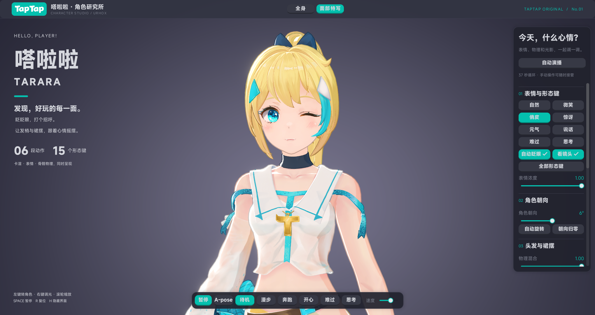
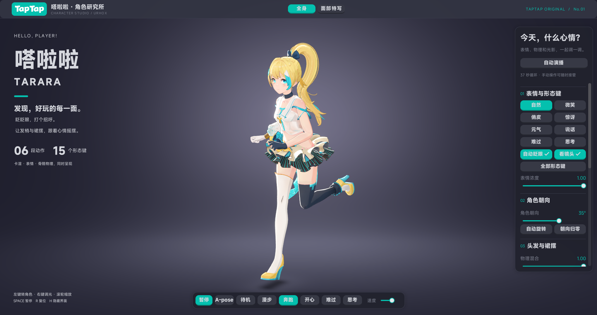

# 嗒啦啦 · Tarara Character Studio

嗒啦啦角色展示：一个角色同时展示卡渲、15 个形态键、眼睛跟随和骨骼物理。默认播放待机，自动眨眼、看镜头和头发、裙摆物理同时开启。

One Tarara character shows Toon shading, 15 authored morph targets, eye contact and secondary motion together. Idle, blinking, eye contact and hair/skirt physics start enabled.

## 运行 / Run

将本目录作为项目根目录。素材已随示例提供。

Use this folder as `-tapcode_dir`. All assets are included.

```powershell
UrhoXRuntime.exe main.lua -tapcode_dir=<本目录绝对路径> -skip_login -nosound -m 4
```

| 输入 Input | 作用 Effect |
|---|---|
| 左键拖动 Left drag | 转动角色 / turn the actor |
| 右键拖动 Right drag | 调主光方位和仰角 / light yaw and elevation |
| 滚轮 Wheel | 缩放 / zoom |
| `Space` / `R` / `H` | 暂停 / 复位镜头和物理 / 隐藏界面 · pause / reset / toggle UI |

右侧面板调表情、形态键、朝向、物理、主光、背景、描边、rim 和不透明度（抖动半透）；底部切换 A-pose、待机、漫步、奔跑、开心、难过、思考。任何手动操作都会停止自动演播。

The side panel controls expressions, morphs, heading, physics, light, backdrop, outline, rim and dithered opacity; the bottom bar selects the bind pose and six clips. Any manual input stops the presentation.

**自动演播 / Presentation**：漫步转一圈 8 秒 → 奔跑转一圈 3.5 秒 → 表情特写 10 秒（正面、左倾、右倾、正面近景，每个镜头两个表情）→ 开心、难过、思考各播一遍并配对应表情。/ Walking turn, running turn, four face close-ups with two expressions each, then the happy, sad and thinking clips once each.

| 表情特写 / Expression close-up | 动作与物理 / Animation with physics |
|---|---|
|  |  |

## 在游戏中复用 / Reuse

`scripts/Character.lua` 是角色入口。动画、形态键、眼睛和物理互相独立，作用于同一个 `AnimatedModel`。两种创建方式得到同一个角色：

`Character.lua` is the entry point; animation, morphs, gaze and physics act independently on one `AnimatedModel`. Both entry points produce the same character:

| 入口 Entry | 做法 How |
|---|---|
| `Character.Load(scene, name)` | 实例化预制体 `Prefabs/Tarara.xml`（默认）/ instantiate the prefab |
| `Character.Create(scene, name)` | 用 `Character.Build` 在 Lua 里逐个创建组件 / build the components in Lua |

预制体就是 `Character.Build` 的序列化结果，不会随 `Character.Build`、模型或材质的修改自动更新；改了这些就用 `Character.Create`。描边不进预制体，由 `Character.Attach` 设置。启动参数 `-studio-character=lua` 改用 Lua 版。

The prefab is the serialized `Character.Build` and does not follow later changes to the build, model or materials; use `Character.Create` after such changes. The outline is set by `Character.Attach`.

```lua
local Character = require("Character")
local hero = Character.Load(scene, "Tarara") -- or Character.Create(scene, "Tarara")
hero:Play("Idle")
hero:SetExpression("smile")
hero:SetPhysics(0.7)
-- Call hero:Update(timeStep, cameraNode.worldPosition) from the scene's Update handler.
```

- **卡渲 / Toon**：`Shaders/BLGL/TararaToon.shader` 使用引擎内置 Toon 光照，rim 强度 `4`，Tonemap `NONE`，不投影。默认主光强度 `1`、颜色 `(255, 242, 232)`、仰角 `25°`、方位 `50°`；描边 `2.5 mm`，深度偏移 `0.02 m`。/ Built-in Toon lighting, rim `4`, no tonemapping or shadows; default light `1` at `25°`/`50°`; outline `2.5 mm` pushed `0.02 m` back.
- **形态键 / Morphs**：保留原始日文通道名，界面显示中文名。权重平滑过渡；自动眨眼叠加在眨眼通道上，笑眼时减弱。/ Original channel names, eased weights, blink added on top and reduced while smiling.
- **眼睛 / Eyes**：`eye_l`、`eye_r` 不受动画驱动，转向镜头，左右最多 `16°`、上下最多 `8°`。/ The eye bones leave the animation and turn towards the camera within `16°`/`8°`.
- **骨骼物理 / Physics**：4 个 `KawaiiPhysics` 组件：马尾、短发束、两条长飘带、其余 20 条裙片。裙片和飘带用大腿、手臂胶囊避让，头发用头部球体避让；前裙片用 `SyncBone` 跟随膝盖向前的位移。碰撞体是近似的，手臂和裙摆仍可能穿插。/ Ponytail, locks, ribbons and 20 skirt chains; approximate thigh, arm and head proxies; the front panels follow the knees through `SyncBone`.
- **舞台 / Stage**：`Studio.lua` 用一张网格做出地面、圆弧转角和背墙（无缝摄影棚），`Shaders/BLGL/StudioStage.shader` 给它上色：墙上一团柔光衬在上半身后面，地面在脚后有一片光。它不受光，不改变角色的光照。落地的脚下有一圈淡淡的光泽和接触阴影，由脚下一小块贴地面片的 `Shaders/BLGL/StudioContact.shader` 画出，只有脚附近的像素参与计算；脚的位置每帧由 `Character:GetContactPoints` 传给 `Studio:SetContactPoints`。地面光泽是假反射，前向渲染下没有真实的屏幕空间反射。/ An unlit infinity cove (floor, curved corner and wall in one mesh) with a soft wall glow and a floor light pool; a small floor patch under the feet adds a contact shadow plus sheen that follow them each frame, so only the pixels near the feet pay for it. The sheen is a stand-in for a reflection.Y 向上、米制；根骨保留源资产的 0.01 缩放，所以碰撞体偏移按骨骼局部厘米填写，半径和长度用米。/ Y-up metres; the root keeps a 0.01 scale, so collision offsets are bone-local centimetres.

## 资源 / Assets

一个模型：141 根骨骼、27 个几何槽、14 份材质、15 个形态键。槽位与材质的对应在 `Character.lua` 的 `MATERIALS`。胸部骨骼没有配置物理。A-pose 是绑定姿态，不是动画。

One model: 141 bones, 27 geometry slots, 14 materials, 15 morphs; `MATERIALS` in `Character.lua` maps the slots. The chest bones have no physics. A-pose is the bind pose.

| 动作 Clip | 时长 Duration |
|---|---|
| 待机 Idle | 4.000 s |
| 漫步 Walk | 1.233 s |
| 奔跑 Run | 0.700 s |
| 开心 Happy | 6.167 s |
| 难过 Sad | 4.333 s |
| 思考 Think | 5.167 s |

动作位于 `assets/Animations/<名字>.ani`，七张颜色贴图位于 `assets/Textures/`。

Clips are `assets/Animations/<Name>.ani`; seven color maps are in `assets/Textures/`.

## 文件 / Files

| 文件 File | 职责 Responsibility |
|---|---|
| `scripts/main.lua` | 生命周期、输入、启动参数 / lifecycle and input |
| `scripts/Character.lua` | 角色：材质、动作、形态键、眼睛、物理、骨链显示 / character |
| `scripts/Studio.lua` | 舞台、相机、光照 / stage, camera and lighting |
| `scripts/Interface.lua` | 自适应界面 / responsive UI |
| `scripts/Presentation.lua` | 自动演播 / presentation |
| `scripts/Utils.lua` | 共用小工具：角度归一化 / shared helpers: angle wrapping |

## 启动参数 / Options

| 参数 Option | 作用 Effect |
|---|---|
| `-studio-character=prefab\|lua` | 创建方式，默认 `prefab` |
| `-studio-framing=full\|face` | 初始镜头，默认 `full` |
| `-studio-expression=<name>` | `neutral`、`smile`、`wink`、`surprised`、`happy`、`speaking`、`sad`、`thinking` |
| `-studio-animation=<name>` | `Pose`、`Idle`、`Walk`、`Run`、`Happy`、`Sad`、`Think`，默认 `Idle` |
| `-studio-yaw=<度>` | 初始朝向，−180～180 |
| `-studio-rotate` / `-studio-demo` / `-studio-bones` | 自动旋转 / 自动演播 / 显示骨链 |
| `-studio-freeze=<N>` | 第 N 次更新后冻结，用于截图 |

## 素材来源 / Provenance

角色和动作来自官方 `TRR` 素材，由 UrhoXCLI 导入。角色环境光来自引擎内置的 `LightGroup/Daytime.xml`。TapTap 标识是引擎随附的官方素材；界面使用 UI 库的深色主题，主色换成 TapTap 青绿，字体为引擎自带的 MiSans。

Character and clips come from the official `TRR` set, imported with UrhoXCLI. Character lighting uses the built-in `LightGroup/Daytime.xml`; the UI uses the dark theme with the TapTap teal accent and the bundled MiSans font.
